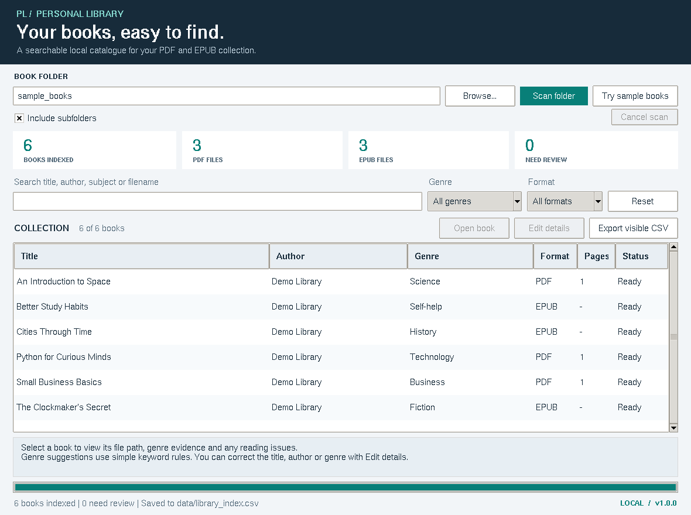

# Personal Library Indexer

A Python desktop application that scans a folder of **PDF and EPUB e-books** and creates a **searchable CSV catalogue** of titles, authors and genres.

Choose a book folder, scan it, and find a book by typing a few words. Everything is processed locally. There are no accounts, API keys, paid services, or database servers to configure.



Actual application screenshot from Linux verification. Font rendering follows the operating system.

## Quick start on Windows

1. Install **Python 3.10 or newer** from [python.org](https://www.python.org/downloads/). Python 3.12 is a good choice for this project. Enable **Add Python to PATH** and include **Tcl/Tk** in the installation.
2. Download or clone this repository. If you downloaded a ZIP, **extract it first**.
3. Open the extracted project folder and double-click **`start_windows.bat`**.
4. On its first run, the launcher creates a local virtual environment and installs the dependency. This needs an Internet connection. Later launches work offline once setup has succeeded.
5. Click **Try sample books**. You should see **6 books: 3 PDF and 3 EPUB**.

The included books are short, original demonstration files. You do not need your own collection to evaluate the project.

## Manual setup

Run commands from the folder containing `app.py` and `requirements.txt`.

### Windows Command Prompt

```bat
py -3 -m venv .venv
.venv\Scripts\python -m pip install -r requirements.txt
.venv\Scripts\python app.py
```

If `py` is unavailable but Python is installed, use `python` in the first command.

### macOS / Linux

```bash
python3 -m venv .venv
.venv/bin/python -m pip install -r requirements.txt
.venv/bin/python app.py
```

On Ubuntu/Debian, install `python3-tk` and `python3-venv` if needed. The desktop app needs a graphical desktop. Use the command-line interface on a server or in a terminal-only environment.

## Features

- Scan a folder, optionally including its subfolders.
- Read PDF and EPUB metadata: title, author, subjects and language.
- Record PDF page count, file size, modification time and relative file path.
- Suggest a genre using explainable keyword rules.
- Search by title, author, subject, genre or filename; filter by genre and format.
- Click a column heading to sort the results.
- View the evidence behind a genre suggestion and any extraction warnings.
- Edit catalogue titles, authors and genres without modifying source e-books.
- Open an original book with the computer's default PDF or EPUB reader.
- Export the currently visible results to a UTF-8 CSV for Excel or LibreOffice.
- Automatically save the complete index and reload it at the next launch.
- Continue scanning when an individual book is damaged or encrypted.
- Cancel a scan after the current file finishes, keeping the previous index.

**Shortcuts:** `Ctrl+F` focuses search. `Ctrl+O` opens the folder chooser. Double-clicking a book row opens its file.

## Two-minute evaluation

1. Launch the app and click **Try sample books**.
2. Confirm the counters show **6 books**, **3 PDF files**, **3 EPUB files**, and **0 need review**.
3. Search for `python`. One book should remain: **Python for Curious Minds**.
4. Reset the filters and select **EPUB**. Three books should remain.
5. Click **Export visible CSV** and save a file. It should contain the three visible EPUB records plus the header.
6. Reset the filters. Select a book and inspect its **genre evidence** below the table.
7. Close and reopen the app. The complete six-book index should reload.

A short [project explanation and viva guide](docs/PROJECT_EXPLANATION.md) describes the design and its limits. See [GitHub upload instructions](docs/GITHUB_UPLOAD.md) to publish your copy.

## Command-line interface

After installing `requirements.txt`, these commands work without a GUI. Use the Python executable from your virtual environment; the examples below assume that environment is activated.

```bash
python cli.py scan sample_books --output output/library_index.csv
python cli.py search output/library_index.csv python
python cli.py search output/library_index.csv --genre History
python cli.py search output/library_index.csv --format EPUB
python cli.py scan sample_books --no-recursive --output output/top_level.csv
```

The first command indexes six books. The last indexes five because the business sample is inside `sample_books/reference/`.

To activate the environment, use `.venv\Scripts\activate.bat` in Windows Command Prompt or `source .venv/bin/activate` in macOS/Linux shells. You can also replace `python` in each example with `.venv\Scripts\python` on Windows or `.venv/bin/python` on macOS/Linux.

The scan command returns exit code `0` when it writes an index, including an empty index or one with per-book warnings. Invalid input or an output error returns `2`; keyboard cancellation returns `130`. Check the CSV's `status` and `notes` fields to identify unreadable books.

## How genre detection works

This is **rule-based classification**, not an AI model. It checks English keywords in this order:

1. Book subjects / keywords.
2. The title.
3. A limited text sample: up to five PDF pages or five EPUB chapters, capped at 24,000 characters.

Each distinct keyword counts once. A title or subject needs at least one matching keyword; body text needs at least two. The category with the most matches wins. Tied categories or insufficient evidence produce **Other** for manual review.

Categories: **Technology, Science, Business, History, Fiction, Self-help, Education, Arts, Other**. The `genre_basis` field records the matching source and keywords. Rules can be changed in `library_indexer/genres.py`.

## Saved files and CSV columns

The desktop app creates these files after a completed scan:

| File | Purpose |
| --- | --- |
| `data/library_index.csv` | Full, portable index using relative book paths |
| `data/session.json` | Local session, including the original folder path |
| `examples/sample_index.csv` | Included example output for the six demo books |

`data/` is excluded from Git. Keep your personal book folders outside the repository or put them in the ignored `books/` folder. A browser upload does not apply Git ignore rules; use the clean extracted download when uploading through the website.

| CSV field | Meaning |
| --- | --- |
| `title`, `author` | Embedded metadata, with filename / Unknown fallbacks |
| `genre`, `genre_basis` | Suggested or manually reviewed category and evidence |
| `format` | PDF or EPUB |
| `pages` | PDF page count; blank for EPUB because its layout reflows |
| `language`, `subjects` | Metadata supplied by the book |
| `relative_path` | Book path relative to the selected folder |
| `size_bytes`, `modified_utc` | File information |
| `status`, `notes` | `ok`, `warning`, `encrypted`, or `error`, with details |

CSV cells that could be interpreted as spreadsheet formulas receive a leading apostrophe. The application's CSV reader reverses that escaping. Source e-books are opened read-only and are never renamed or rewritten.

The GUI's saved JSON session is its source of truth at startup. The CLI writes only the CSV you request; it does not replace the GUI's saved session.

## Project structure

| Path | Responsibility |
| --- | --- |
| `app.py` | Desktop entry point and startup checks |
| `cli.py` | Terminal scan and search commands |
| `library_indexer/gui.py` | Interface, background scan queue and user actions |
| `library_indexer/scanner.py` | Folder traversal, progress and per-file errors |
| `library_indexer/extractors.py` | PDF and EPUB metadata / text extraction |
| `library_indexer/genres.py` | Genre keyword rules |
| `library_indexer/catalog.py` | Search, CSV, local persistence and file path checks |
| `library_indexer/models.py` | Book and scan result data classes |
| `sample_books/` | Six original demo e-books |
| `tests/` | Automated behaviour tests |
| `tools/make_sample_books.py` | Optional demo-book generator |
| `docs/` | Upload guide and project explanation |

## Run the tests

```bash
python -m unittest discover -s tests -v
```

The tests use Python's standard `unittest` library. They cover real sample extraction, recursive scanning, search, genre rules, CSV round trips, cancellation, persistence, invalid files, encrypted files, path handling and the CLI. No test framework needs to be installed.

The included GitHub Actions workflow runs the core tests on Windows and Ubuntu with Python 3.12 after pushes and pull requests. This workflow runs on GitHub after upload; it is not a hosted version of the desktop application.

See [verification notes](docs/VERIFICATION.md) for the checks completed on this release and their limits.

## Limitations

- **Genre suggestions can be wrong.** The rules are English-based and do not understand the full meaning of a book. Unicode metadata, including Tamil, can still be stored and searched.
- **No OCR:** an image-only scanned PDF can provide metadata but not a body-text genre signal.
- **No DRM or password removal:** encrypted PDFs are listed as locked. Unreadable EPUB chapters are reported; available metadata may still be indexed.
- A file larger than **100 MiB** is recorded as an error. EPUB member reads have a **4 MiB** limit and chapter sampling is bounded. These limits keep the student project manageable; they are not a general guarantee against hostile files.
- Rescanning rebuilds the current catalogue and replaces manual edits. Export a CSV first if you need to preserve edited results.
- A moved or deleted book remains in the saved index until the next scan. Rescan its current folder to update paths.
- Only one catalogue is loaded at a time. Scanning a new folder replaces the previous catalogue after completion.
- The collection is held in memory. This project is intended for personal collections, not millions of documents.

## Troubleshooting

| Problem | Fix |
| --- | --- |
| Python is not found | Install Python, enable Add Python to PATH, and open a new terminal |
| `No module named pypdf` | Run `python -m pip install -r requirements.txt` using the same Python that launches the app |
| `No module named tkinter` | Install `python3-tk` on Ubuntu/Debian, or enable Tcl/Tk in the Windows Python installer |
| No display / no `$DISPLAY` | Use a graphical desktop or use `cli.py` |
| Book count is zero | Select the folder containing `.pdf` / `.epub` files and enable Include subfolders if needed |
| Could not save / permission denied | Extract the project to a writable folder; close the CSV in Excel and try again |
| A book cannot be opened | Install or select a default PDF/EPUB reader; confirm the source file still exists |
| Saved index is damaged | Scan a folder again; a completed scan rebuilds the local saved files |

## Optional: rebuild the demo books

The files are already included. Only developers regenerating them need ReportLab:

```bash
python -m pip install reportlab
python tools/make_sample_books.py
```

## References and license

- [Python Tkinter documentation](https://docs.python.org/3/library/tkinter.html)
- [pypdf installation](https://pypdf.readthedocs.io/en/stable/user/installation.html) and [metadata documentation](https://pypdf.readthedocs.io/en/stable/user/metadata.html)
- [GitHub: adding files to a repository](https://docs.github.com/en/repositories/working-with-files/managing-files/adding-a-file-to-a-repository)

Project code and original demo text: [MIT License](LICENSE). Third-party libraries retain their own licenses. The bundled PDF font notice is in `docs/THIRD_PARTY_NOTICES.txt`.
